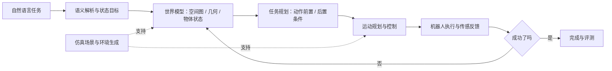

# 大知识框架｜先懂系统，再记名词

## 0. 一个任务看懂具身智能

用户说：“进入隔壁房间，把桌上的水杯拿来。”

难点不只是让场景有门，还要确保：**图上连接、几何可通行、状态允许、机器人有能力、物理执行成功**。这五件事逐层加约束，不能相互替代。

## 1. 两条技术主线和共同底座

**主线 A｜空间与任务智能**
- 任务理解：语言 → 任务目标 / 结构化约束 / 动作语义。
- 空间表示：Spatial Graph、节点边、世界/局部坐标、几何 Box、接触 witness。
- 几何与逻辑：Z3/SMT、合法性、邻接、重叠、楼层连接、门洞、净空。
- 状态与任务：FSM、PDDL、TAMP、动作前置条件、资源和时间约束。
- 执行：URDF、ROS2、TF、Nav2、FK/IK、物理和传感仿真。
- 验证：环境合法率、任务成功率、解释性、跨布局泛化、人工修复耗时。

**主线 B｜感知与多模态交互**
- 感知：FMCW 雷达、RGB-D、SAR、光学/红外、环境传感器。
- 信息融合：时间对齐、坐标配准、证据来源、置信度、误报和漏报。
- 人机对话：VAD → ASR → LLM → 流式 TTS，支持打断和状态同步。
- 数字人：Mesh/Skeleton/Blendshape、VRM/Live2D、FLAME/SMPL-X、3DGS。
- XR：AR/VR 6DoF、Spatial Anchor、WebRTC、时延/丢包与远程触觉。

**共同理论底座**
向量与 SE(3) 变换、图论、离散状态/自动机、优化与约束、概率不确定性、控制与评测方法。已有 Python / UE / PCG 作为实践工具，不再学习变量/基础蓝图/PCG 入门。

## 2. 简历项目和能力矩阵

| 项目 | 核心学习问题 | 主要知识对应 | 自己必须能解释 |
|---|---|---|---|
| Einstein Layout | 多层建筑约束如何联合求解？ | Spatial Graph、Z3/SMT、Contact Witness、失败诊断 | 房间尺寸、邻接、门/楼梯合法性、无解处理 |
| Genesis Scene / Tairos | 如何从生成内容走向机器人任务环境？ | AI+PCG、资产、仿真、任务评测 | 真实贡献、场景表示、仿真缺口 |
| 无限画布 | 多模型异步生成的可靠性如何保障？ | LLM/Agent、任务状态、重试和结果回填 | 任务 ID、状态一致性、异常恢复 |
| SceneWeaver | 空间能走通为何任务仍失败？ | 场景结构、约束、PDDL/TAMP、任务状态 | 已实现部分与拟研究问题边界 |
| INZ Lab | 数字人怎样与语音、动作同步？ | 3DGS、FLAME/SMPL-X、Blendshape、流式语音 | 输入输出、延迟、驱动与渲染差别 |
| AI Partner | 虚拟陪伴怎样保持连续表达？ | VRM/Live2D、STT–LLM–TTS、记忆 | 语音-表情同步、状态一致性 |
| 陪伴机器人 | 如何减少误报并维护用户自主权？ | FMCW、环境感知、多模态对话、分级提醒 | 信号置信度、运动干扰、非医疗边界 |
| 天穹慧眼 | 多源数据怎样转可信决策？ | SAR/光学/红外、时空对齐、证据链 | 不同来源的矛盾与人工复核 |
| Rove | 两端如何共享空间、同步动作、反馈触觉？ | 6DoF、配准、WebRTC、触觉授权 | 延迟、漂移、跟踪丢失、安全边界 |

## 3. 必须区分的六组概念

| A | B | 为什么不能混淆 |
|---|---|---|
| 拓扑连通 | 几何可通行 | 图中有边，不保证门够宽、净空足够 |
| 几何可通行 | 任务可执行 | 进得去，不代表能开锁、抓取或完成任务 |
| 任务规划 | 运动规划 | “先开门再抓杯”与“关节怎样运动”是不同层级 |
| UE 场景生成 | 机器人仿真 | 渲染资源不自动包含物理、传感和控制接口 |
| 3DGS 重建 | 可驱动数字人 | 可看不代表有骨骼、表情和稳定动画参数 |
| AI 建议 | 可靠决策 | 需有数据来源、约束检查、不确定性与人工接管 |

## 4. 掌握等级

- **三级（核心）**：能从原理推导、针对失败改变约束或系统设计、独立回应多轮追问。空间、SMT、具身任务、机器人接口优先。
- **二级（系统）**：能画准确架构，说明输入输出、时序、局限并分析一个实际案例。ROS2、IL/RL/VLA、多模态语音等。
- **一级（认知）**：理解适用场景与边界，知道哪些模块需要专家协作。SAR 细分算法、底层控制、全套 XR 标定等按时间分配。

> 目标不是在 14 天把所有知识做到三级，而是让简历最核心的技术主线达到三级，其他技术具备诚实且可追问的认知。

## 5. v2 新增：机器学习策略真正需要的“环境任务契约”

> 对具身训练与验证，生成环境只解决一部分工作；要让策略/控制器“能用”，至少明确以下字段：

| 层次 | 示例字段 | 谁负责？ | 面试高频追问 |
|---|---|---|---|
| 场景（Scene） | rooms/doors/objects, metric frame, collision geometry | 环境构建与物理资产 | 尺寸、单位、碰撞、门洞接面是否正确？ |
| 任务（Task） | initial predicates, goal, constraints | 任务/规划设计 | 任务完成条件如何定义？ |
| 机器人（Robot） | joint limits, URDF, end-effector, robot capabilities | 机器人模型/控制 | 能力与空间要求是否匹配？ |
| 观测（Observation） | RGB-D、状态/关节、时间戳、可见性 | 传感器与状态估计 | 机器人看见什么，不能假设全知状态？ |
| 动作（Action） | 关节/末端目标，持续时间，反馈 | 控制器/策略 | 谁从任务动作得到可执行控制？ |
| 训练（Learning） | reward, resets, terminations, dataset, episode | 学习任务 / Isaac Lab | 奖励、重置、成功率怎样不泄漏？ |
| 评测（Evaluation） | task_id, seed, success, error, baseline | 实验与评测工具 | 怎样公平证明方法增益？ |

特别注意：[Isaac Sim](https://docs.isaacsim.omniverse.nvidia.com/latest/core_api_tutorials/index.html) 与 [Isaac Lab](https://docs.nvidia.com/learning/physical-ai/getting-started-with-isaac-lab/latest/isaac-lab-basics/01-the-isaac-platform.html) 不是同一个职责。

## 6. v2 新增：世界模型概念警戒线

“世界模型”至少有两种常见用法：
- 你的 **符号/结构化环境模型**：几何、空间图、门状态、任务谓词。是工程数据表达，不能因用到了 LLM 就称为已训练的世界预测模型。
- 学习型 **动态世界模型**：从观测和行动预测未来状态/视觉/潜变量，常用于规划/策略学习；不等于带门房间图，也不等于 3DGS。

R18 的 π0、[LeRobot](https://huggingface.co/docs/lerobot/index) 与 [MIT Task-and-Motion Planning](https://manipulation.mit.edu/) 适用于不同系统层级。能说清差异比只追求新术语更重要。