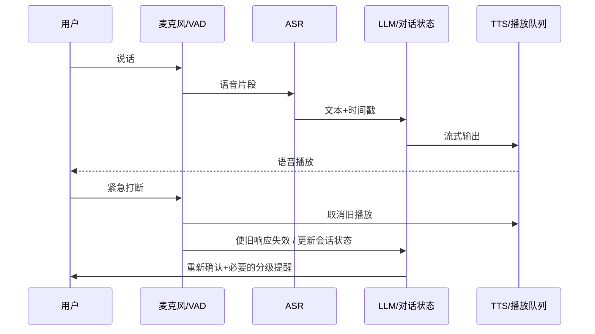

# 贯穿全程的最小实践与验收设计

## A. 核心：具身任务环境生成与验证（Day 1–7）

**最小问题**：自然语言希望“机器人从 A 房间穿过门 D 到 B 房间抓取物体 O”。场景既需要几何合法，也需要物体状态允许执行动作。

### 最小输入表示（示意，不是现有项目中实际已运行的接口）

```json
{
  "rooms": [
    {"id":"A","box":[0,0,4,4]},
    {"id":"B","box":[4,0,8,4]}
  ],
  "doors": [{"id":"D","between":["A","B"],"width_m":0.9,"locked":false}],
  "robot": {"width_m":0.6,"start":"A"},
  "objects": [{"id":"O","room":"B","graspable":true}],
  "goal": "hold(O)"
}
```

**实现/推演顺序**

1. **图合法**：房间节点与门边是否存在，连通关系是否一致？
2. **几何合法**：Box 边界、非重叠、门洞与接面是否存在，单位是否一致？
3. **通行合法**：机器人宽度、门净宽、姿态、障碍碰撞（受限规则，不代替完整运动规划）。
4. **状态可执行**：门是否锁定，是否持有钥匙，前置条件和效果能否逐步满足？
5. **评测**：成功/失败原因分类、求解时长、人工修改次数、重复实验数据。

### 必测反例

| 案例 | 图连通 | 几何/动作问题 | 期望输出 |
|---|---|---|---|
| 普通开门 | 是 | 门宽充足，未上锁 | 受限规则下可执行 |
| 门宽太窄 | 是 | 机器人无法通过门洞 | 不可通行；指出门宽/机器人尺寸 |
| 门被锁 | 是 | 没有开锁能力/钥匙 | 当前状态不可执行；指出动作前置缺失 |
| 房间重叠 | 可能 | 几何布局违规 | 求解/几何校验失败 |
| 楼梯净空不够 | 是 | 连接存在但几何不满足 | 失败定位到楼层接面或净空 |
| 任务目标缺失 | 是 | 目标物体/状态不存在 | 任务解析或状态错误 |

**不虚构成果**：如果未接入真实 robot、ROS2、UE 自动场景导出，不得把脚本输出称为“机器人仿真任务成功”。必须分别记录 *静态合法*、*受限任务规划可行* 与 *真实/仿真执行成功*。

## B. 多模态陪伴交互（Day 9–11）



- 输入可是真实语音或**标注为模拟**的事件流。
- 异常提醒：传感低置信度→主动核实→分级提醒→用户可撤回/人工复核。
- 不将示例或模拟结果表述为医疗级监测能力。

## C. 多源态势感知（Day 12）

| 系统阶段 | 需要回答的问题 | 失败情况 |
|---|---|---|
| 多源接入 | 数据来自 SAR/光学/红外/无人机中的哪种？ | 来源缺失 |
| 时空对齐 | 采集时间、分辨率和地图坐标一致吗？ | 误配同一目标 |
| 事件关联 | 多源证据是同一事件吗？ | 假关联或漏关联 |
| 可信度与溯源 | 为什么系统作出这一判断？ | 置信度无依据 |
| 人工核验 | 人怎么纠正、回滚和重新发起任务？ | 过度自动化 |

## D. Rove 双端 XR（Day 13）

- 统一坐标：共享 Anchor / 重定位 / 6DoF 变换矩阵。
- 传输：媒体流优先看 WebRTC，控制/业务状态可使用 WebSocket；二者可能组合。
- 一致性：时间戳、跟踪置信度、姿态重定向、丢包/漂移。
- 安全：触觉动作应有明确授权与撤回通道；不能对真实人身安全作无证据保证。

## E. 留存证据的最低标准

每个测试或设计至少保存：`输入/前提条件`、`版本/工具`、`预期`、`实际输出`、`失败记录`、`结论与局限`。可以是 Markdown 表格或截图，严禁在尚未运行时填“PASS”。


## F. v2：接近真实研究水平的评价协议（没有真实设备也能完成设计）

**评测对象**：同一组任务要求下，机器人环境自动生成/验证是否优于公平对照；不要把渲染图满意度作为机器人执行成功率。

**基线（至少一个）**：B0 人工固定模板或约束固定手工布局；B1 简单随机/规则 PCG，只检查静态连通；B2 主方法在相同时间/资产池/任务上附加约束与任务检查。若原项目已有强基线，优先比较真实同等级基线。

**共同控制条件**：相同机器人形态与碰撞体、相同随机种子集合、资产池、尺寸限制、任务目标、执行预算、人工修复计时方法。每个样例记录版本/输入/种子/最终状态/失败类别。

| 测量 | 如何定义 | 注意避免 |
|---|---|---|
| 几何合法率 | 几何/碰撞/尺度检查通过样例占比 | 不把 Z3 sat 当成实际合法 |
| 规划可行率 | 任务规划器在给定机器人模型与动作集合下找到合法计划占比 | 不等于物理执行成功 |
| 实际仿真成功率 | 使用同一评测控制器/策略，达到目标状态的回合占比 | 没跑真实仿真时绝不可填数字 |
| 诊断准确性 | 预设错误类别中正确指出真实致错原因的比例 | 不能用原因描述“看起来合理”替代验证 |
| 人工修复代价 | 每个任务从接到失败到满足条件的人工分钟数及次数 | 两组需统一计时和允许工具 |

**建议 8 类受限测试**：正常可行；AABB重叠；门接面不相容；机器人太宽；门被锁且无钥匙；钥匙可获取但需要重规划；目标物不可抓/超出可达；跨层楼梯/电梯不可用。

**基准参考**：[BEHAVIOR-1K](https://behavior.stanford.edu/) 的长时任务与可交互场景；[MIT Robotic Manipulation](https://manipulation.mit.edu/) 的感知→运动规划→执行接口；[Isaac Lab](https://docs.nvidia.com/learning/physical-ai/getting-started-with-isaac-lab/latest/isaac-lab-basics/01-the-isaac-platform.html) 的观测/动作/奖励/重置定义。

**不要冒充本项目已经跑通的数据**：这里是用于新学习/研究计划的评测设计，数据栏开始时必须空白。任何结果只有确实有执行命令、版本、日志、截图/指标后才写“实测”。