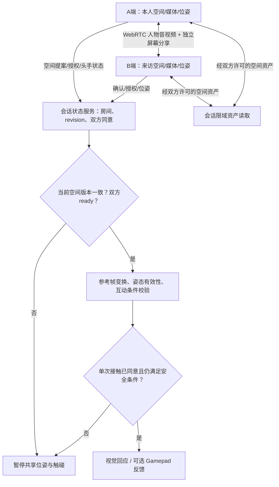

# Belean 比邻｜空间共在、实时交互与安全状态的一体化项目学习指南

> **教学边界**：这是根据用户授权访问的 **Belean 私有工程资料**抽象出的学习教材。此 `14plan` 仓库是 Public：不复制原工程内部代码、真实房间/真人数据、受限素材、令牌或未公开的精确实验配置。用户如果需要核实个人贡献，应在自己的私有 Belean 工作区读取原始提交与执行日志，不将证据搬到此处。
>
> **项目身份**：远程空间共在与人际互动的在研产品/创业探索；不是一个已经实现实体机器人遥操作的系统，也没有可验证的商业化/用户留存结论。

## 1. 一句话先理解 Belean

**让相隔两地的两个人，在双方明确同意的空间里相见、交谈、共享活动，并在条件允许时进行可撤回的虚拟触碰。**

不是单纯“头显视频聊天”，更不是所有能力都做完了的全息触觉产品。学习时要把 **用户需求 → 共享世界/身份 → 实时媒体和位姿 → 授权 → 可用体验与安全退出** 连成系统。

### 与具身智能的准确联系
- **场景智能**：共享环境、坐标和资产的表示与版本一致性；
- **动作和观测**：人体头/手 6DoF、跟踪有效性、时间戳与远端人物表达；
- **人机交互与协作**：两个人在同一空间对象上建立共同注意、协商互动；
- **安全闭环**：本地真实安全区、授权、接触条件、失效停止。
- **不能强行宣称**：它已经实现机械臂遥操作、机器人控制/感知策略训练或真实力反馈。这些研究不应替代现有产品证据。

## 2. 把目前“有软件证据”和“仍研究”严格分开

| 能力模块 | 当前软件原型的范围 | 仍需要额外证明的部分 |
|---|---|---|
| 双人会话和空间选择 | 邀请加入、实测尺寸或静态 GLB / 示例空间、提案、另一方接受、双方确认进入 | 跨地域真实用户连续使用、多次主动复用 |
| 媒体与共同活动 | WebRTC 人物音视频、独立屏幕分享连接；房间服务处理信令与状态 | 双独立网络持续质量与延迟、跨平台媒体兼容 |
| 共享位姿 | 桌面模拟或 WebXR 头部/双手输入、手动地面和朝向对齐、过期/旧版本拒绝 | 实际双头显准确度、长时漂移、全身和面部真实追踪 |
| 远端人物与声音 | 2D 远端摄像头视频平面、简化人物回退；可选 HRTF 空间声音 | MetaHuman/可动画真人 3DGS 远端角色在真实设备上的端到端体验 |
| 触碰 | 双方允许请求、接收者逐次接受、视觉反馈/可选兼容 Gamepad 振动及本地停止 | 物理触觉手套/腕带、压力/反作用力、真正的佩戴安全与量化时延 |
| 空间建模研究 | 静态 GLB 验证，程序生成的高斯空间和代理等**合成隔离实验** | 两处真实私人空间扫描、3DGS 与碰撞代理正确性、双目/真实安全区验收 |

**注意证据级别**：`应用里有该功能逻辑`、`自动化测试通过`、`同机两浏览器实测`、`两台物理设备实测`、`真实用户验证`是五种不同级别。项目记录报告的软件测试，不能代替后两项。

## 3. 先画系统结构，再背术语

### 必须画出来的三个不同“身份”
- **会话创建者**：用于房间生命周期；不天然代表选中的空间是谁提供。
- **空间提供者/主场**：这次提供房间模型或尺寸的成员；可以不同于创建者。
- **双方主动确认状态**：一人同意提案并不等于双方已加载并进入当前空间。切换 revision 后必须重新检查。

### 为什么 WebRTC 不替代 WebSocket？
示例原型中，媒体由 WebRTC 连接承担；WebSocket 服务用于信令、应用状态、位姿和授权；受限空间模型独立走 HTTP。**不能误写成“所有头手位姿都必须由 RTCDataChannel 传输”**，更不能认为视频连接成功就表示空间坐标已经对齐。

## 4. Day13 三个亲手完成的练习

### 练习A｜双人换空间的事务状态（建议40分钟）
用以下简化事件表画状态机：

| 事件 | 当前修订 | 谁 ready | 应否允许触碰 |
|---|---:|---|---|
| 两人处于已确认空间 | 7 | A+B | 还需额外的追踪、授权、接近及本地安全检查 |
| B提议新房间 | 7，待处理8 | 旧ready失效路径需要评估 | 不应凭“B已经预览”直接允许新空间触碰 |
| A接受并发布新空间 | 8 | 暂无双方确认 | **否** |
| A确认进入，B仍加载中 | 8 | A | **否** |
| B也确认，并有新鲜位姿 | 8 | A+B | 只表示通过空间就位门；触碰仍需当次授权等检查 |
| 旧 revision 7 手部包迟到 | 8 | A+B | **拒绝旧包** |

注意：此表是**教学抽象**，不是复制项目内部协议字段。真正的软件状态与协议设计、未来更复杂的 v2 active/pending/fallback 需分别论证。

### 练习B｜双设备坐标系手算（建议30分钟）
使用列向量约定：`T_shared_A`把A设备局部点变共享世界，`T_shared_B`把B局部点变共享世界。`p_A=(0.2,0,0)`，两个变换只有平移 `(+1,0,0)`和`(+3,0,0)`，则：
`p_B = inverse(T_shared_B) * T_shared_A * p_A = (-1.8,0,0)`。
再自行将A增加绕竖直轴90度旋转，推算完整变换方向。**连接成功与空间对齐是两个独立条件**。

### 练习C｜触碰如何安全失败（建议50分钟）
画出 `双方愿意请求→两人位置有效→距离/空间一致→接收方当次接受→输出→回执`，再测试以下反例：
- 空间从 revision7 切到8，旧手部位姿和旧触碰许可迟到；
- 网络不断但跟踪丢失；
- 接收方撤回许可，输出队列还保存旧事件；
- 可视化高斯桌面存在，但实际碰撞/接触代理缺失。

按`预期状态→收到事件→应拒绝/降级的理由→恢复所需条件`记录，**不得称已测实体压力或佩戴安全**。

## 5. 需要怎样看课程？

**Day13 必修**：[R15 WebRTC](../STUDY_GUIDES/R15.md)（信令、STUN/TURN、媒体和共享状态）+ [R21 参考空间](../STUDY_GUIDES/R21.md)（实际WebXR与OpenXR概念分开）+ [R01 刚体变换](../STUDY_GUIDES/R01.md)（只复习坐标方向）。

**Day10 延伸**：[R11 3DGS](../STUDY_GUIDES/R11.md)（空间的外观层并非实体几何）+ [R12 真人表征](../STUDY_GUIDES/R12.md)（可编辑Rig/MetaHuman与可动画高斯仍待真机对照）。

### 面试里如何介绍（不要硬往机器人遥操作上靠）
先讲真实需求：异地两个人不只是彼此听到声音，还希望理解共同空间和对方动作。再讲**最小软件证据**：双人选择空间、确认、媒体与状态同步、单次互动权限。最后讲在研难题：真实房间/人物的表征、异构AR/VR参考系、足部与表情观察、双目渲染与触觉安全。**离完整真人双地共处还有设备与真实体验验证缺口**。

## 6. 自查和证据边界
- 能自己解释一个共享空间版本不一致的失败。
- 能独立画出 WebRTC媒体、WebSocket 状态、HTTP资产三条通道与各自的权限。
- 能说明GLB静态房间与3DGS扫描研究的区别、真实物理安全区不能从外观几何直接得出。
- 能明确说出：2D远端人物/可选Gamepad已在软件设计中，MetaHuman/动态高斯/全身追踪/实体触觉尚需实机。

由于源仓为私有，正式简历或对外汇报应在权利及披露边界确认后使用自己的可公开证据。文中的合成练习不属于已完成历史成果。

[Day13](../DAILY/day-13.md) · [独立任务手册](../TASK_GUIDES/day-13.md) · [参考答案](../TASK_GUIDES/ANSWERS/day-13.md) · [全部资源](../STUDY_GUIDES/README.md)
