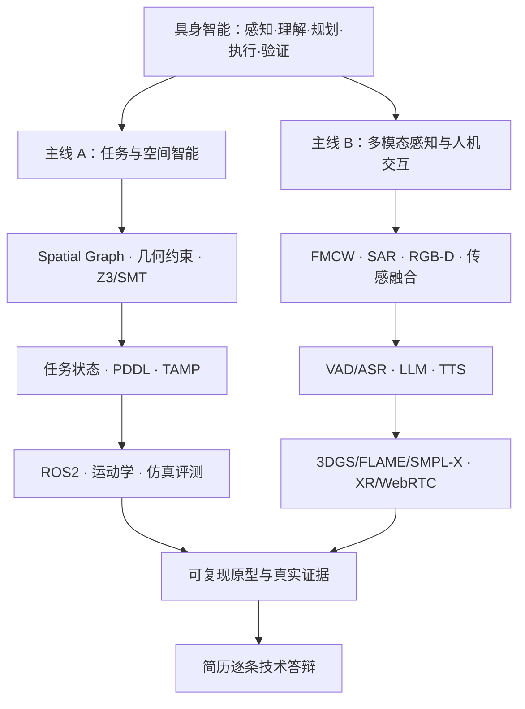

# 具身智能特训营｜14 天、140 小时面试冲刺

> **2026-10-20 — 2026-11-02** · 每天 10 小时 · 目标：具身智能特训营 11 月初面试
>
> 学习策略：**已有 Python 编程、UE5 和 PCG 基础，不再补编程/引擎入门。** 把时间用于机器人学、空间约束、具身任务、仿真、多模态、传感器、数字人、XR 和科研答辩。

**开工顺序：** 先读 [知识地图](KNOWLEDGE_MAP.md) → 再读 [14 天完整计划](PLAN_14_DAYS.md) → 点开[当天学习页](DAILY/) → 每日更新 [进度看板](PROGRESS.md) 和每日记录。

## 一眼看懂这次冲刺

- **30h** 空间表示、Z3/SMT、任务状态与 TAMP（Day 1–3）
- **40h** 运动学、ROS2、仿真、模仿学习 / RL / VLA（Day 4–7）
- **10h** Genesis Scene / Tairos / SceneWeaver / 无限画布技术复盘（Day 8）
- **20h** 实时语音、数字人、情感交互（Day 9–10）
- **20h** FMCW、SAR、RGB-D、多源感知（Day 11–12）
- **10h** XR / WebRTC / 姿态与触觉（Day 13）
- **10h** 全简历模拟面试与复盘（Day 14）

## 14 天总览

| Day | 日期 | 主题 | 完成标志 |
|---:|---|---|---|
| [01](DAILY/day-01.md) | 10/20 | 世界模型与空间表示 | 统一表达房间、门、楼梯、物体、机器人 |
| [02](DAILY/day-02.md) | 10/21 | 约束求解 / Z3 / SMT | 3 个可满足 + 3 个不可满足案例 |
| [03](DAILY/day-03.md) | 10/22 | PDDL / 状态 / TAMP | 带门锁的任务状态图与失败分支 |
| [04](DAILY/day-04.md) | 10/23 | 机器人运动学 | 独立解释 FK / IK / Jacobian / 奇异性 |
| [05](DAILY/day-05.md) | 10/24 | ROS2 / TF / Nav2 | 机器人系统通信与执行架构图 |
| [06](DAILY/day-06.md) | 10/25 | Isaac Sim / 物理仿真 | UE 资产到可用仿真环境检查清单 |
| [07](DAILY/day-07.md) | 10/26 | IL / RL / VLA | 四类策略方法及环境需求对照 |
| [08](DAILY/day-08.md) | 10/27 | AI 场景生产与项目复盘 | 3 条真实技术链路、职责、局限 |
| [09](DAILY/day-09.md) | 10/28 | VAD / ASR / LLM / TTS | 可打断语音与安全响应时序图 |
| [10](DAILY/day-10.md) | 10/29 | 3DGS / FLAME / SMPL-X | 数字人驱动链路与表示比较 |
| [11](DAILY/day-11.md) | 10/30 | FMCW 毫米波 | 信号链路与误报风险清单 |
| [12](DAILY/day-12.md) | 10/31 | SAR / RGB-D / 融合 | 多源观测到人工复核的架构图 |
| [13](DAILY/day-13.md) | 11/01 | XR / 配准 / WebRTC | 双端共在、延迟降级、触觉安全 |
| [14](DAILY/day-14.md) | 11/02 | 全真模拟面试 | 两轮深挖 + 薄弱点复盘 |

## 每天怎么学（10h，休息另计）

1. **2h 课程**：带着问题看 B 站指定选集，不刷完整合集。
2. **3h 原理**：画流程、写输入输出、推导关键定义与约束。
3. **3h 验证**：用简历项目做最小实验、对照案例或系统设计；Codex 可辅助执行。
4. **1h 复述**：关掉资料，用自己的话讲为什么、怎么做、哪里失败。
5. **1h 面试**：让 AI 连续追问；把不懂的问题写入错题簿。

每天只用回答五个问题：**它解决什么？输入输出？为什么选它？怎么做/测？在哪些条件下失败？**

## 关键文件

- [知识地图与项目映射](KNOWLEDGE_MAP.md)：先建立全局认知，避免孤立背术语。
- [每日详细学习计划](PLAN_14_DAYS.md)：14 天依赖关系、主题、验收、优先级。
- [精选资源（B 站优先）](RESOURCES.md)：直接可点、按照 Day 编号对应，避免找课。
- [实践与验收](PRACTICE_PROJECTS.md)：空间/任务验证主实验 + 语音与传感架构。
- [技术面试 45 问](INTERVIEW_QUESTIONS.md)：含答题抓手和交叉追问。
- [简历真实贡献核查](CV_EVIDENCE_AUDIT.md)：项目事实、团队成果、个人贡献、拟研究方向分开。
- [进度看板](PROGRESS.md)：每日勾选、掌握度 0–3、风险与调整。
- [Codex 教练 Prompt](PROMPTS/CODEX_COACH.md)：项目学习、实测与追问一体化流程。
- [每日复盘模板](TEMPLATES/DAILY_REVIEW.md)：按需复制到 `LOGS/`。

## 重要边界

- 14 天不能真正精通简历涉及的所有学科，目标是**核心能力能深挖、外围技术懂工作原理、未做过的东西诚实说明**。
- **原型 / 模拟 / 研究方向**不等于**真实机器人执行 / 硬件验证 / 已完成个人贡献**。
- 腾讯团队成果、个人工作、未来入营设想要严格区分；仓库中不存放任何实习公司的内部资料、非公开代码、用户隐私或简历联系方式。
- 课程资料属于外部作者，仅存链接与学习索引，不搬运视频、付费内容或受版权保护的课程文件。

> 使用日期基于 2026 年 11 月初面试；实际面试若更早，优先完成 Day 1–8 与 Day 14，后续选修压缩。