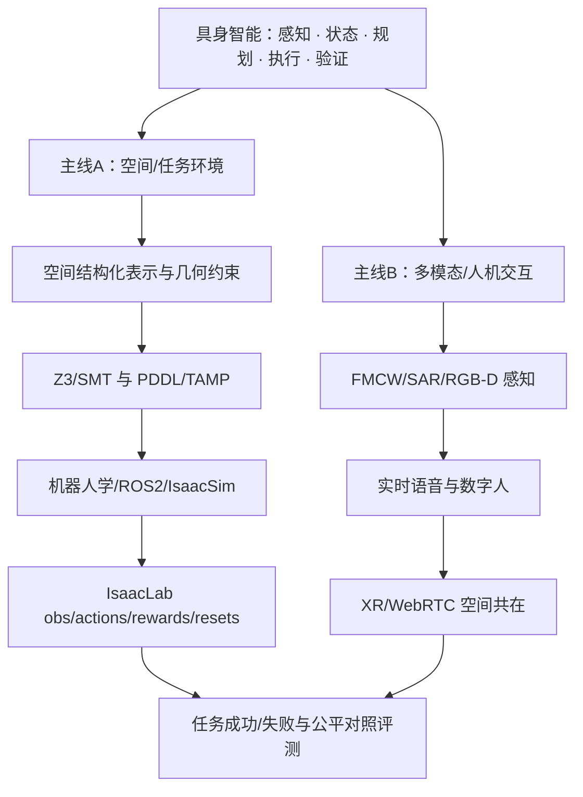

# 具身智能特训营｜14 天 × 10 小时面试冲刺（2026 课程严选 v2）

> **日期：2026-10-20 → 2026-11-02 | 140 有效学习小时 | 面试：11月初**
>
> 已有 Python 开发、UE5 与 PCG 基础。**不重复补编程/引擎入门**；重点学空间约束、机器人学、真实机器人任务接口、多模态感知、科研评测与技术面试。

## 今天就这样开始

1. **先读 [知识地图](KNOWLEDGE_MAP.md)**（15–20分钟），建立两条技术主线；不要把世界结构化表示与学习型世界模型混为一谈。
2. **看 [课程严选与筛选依据](COURSE_AUDIT.md)**（约10分钟），知道哪些是大学主课、哪些是 B站讲解，为什么替换。
3. **打开 [Day 01](DAILY/day-01.md)**，先完成 **45 分钟闭卷前测**，再进入世界表示与几何学习。
4. **每一天按 [DAILY/](DAILY/) 的唯一计划执行**，不是固定刷 2h B站。当天只需官方文档就不必硬找视频。
5. 按 [学习协议](LEARNING_PROTOCOL.md) 的 D+1/D+3/D+7 复习，按 [阶段考核](CHECKPOINTS.md) 做 5 次检查。

## 系统地图：不是几十门互不相干的技术

**核心区别**：空间图有连接 ≠ 实际有通路 ≠ 门可以开 ≠ 机器人有能力执行 ≠ 策略在仿真/现实中成功。

## 快速导航

| 我想做什么 | 入口 | 时间/用途 |
|---|---|---|
| 看整体地图及简历项目对应关系 | [KNOWLEDGE_MAP.md](KNOWLEDGE_MAP.md) | 优先读 |
| 看 14 天宏观排期 | [PLAN_14_DAYS.md](PLAN_14_DAYS.md) | 每天10h |
| 打开当天课程与任务 | [DAILY/day-01.md](DAILY/day-01.md) → [全部 DAILY/](DAILY/) | 每天唯一执行页 |
| 找 B 站与大学级主课 | [RESOURCES.md](RESOURCES.md) | 章节/选集/官方备选 |
| 看旧版课程为何被替换 | [COURSE_AUDIT.md](COURSE_AUDIT.md) | 透明核查 |
| 比较旧版与新版（保留不可变历史） | [CHANGELOG.md](CHANGELOG.md) | 版本差异及 v1 入口 |
| 读少量原始论文/评测基准 | [PAPER_READING.md](PAPER_READING.md) | MIT、π0、LeRobot、BEHAVIOR |
| 学习法、闭卷自测、评分阈值 | [LEARNING_PROTOCOL.md](LEARNING_PROTOCOL.md) | D+1/D+3/D+7 |
| 阶段模拟面试 | [CHECKPOINTS.md](CHECKPOINTS.md) | Day3/7/10/12/14 |
| 学空间/任务的最小可证伪验证 | [PRACTICE_PROJECTS.md](PRACTICE_PROJECTS.md) | 无真实设备也可完成 |
| 面试题与连续追问 | [INTERVIEW_QUESTIONS.md](INTERVIEW_QUESTIONS.md) | 至少 57 问 |
| 区分团队成果、个人贡献和拟研究 | [CV_EVIDENCE_AUDIT.md](CV_EVIDENCE_AUDIT.md) | 禁止倒填 |
| 用 Codex 帮助真实学习 | [PROMPTS/CODEX_COACH.md](PROMPTS/CODEX_COACH.md) | 不代替思考 |
| 进度、自测、复习与时间使用 | [PROGRESS.md](PROGRESS.md) | 每天更新 |

## 学习日程总览

| Day | 日期 | 主题 | P级别 | 最重要的验收 |
|---|---|---|---|---|
| [Day 01](DAILY/day-01.md) | 10/20 | 世界模型与空间/几何 | P0 | 五层世界表示+反例 |
| [Day 02](DAILY/day-02.md) | 10/21 | Z3/SMT 编码与无解诊断 | P0 | 3 sat/3 unsat+core |
| [Day 03](DAILY/day-03.md) | 10/22 | PDDL/TAMP 联合规划 | P0 | 任务状态/几何冲突 |
| [Day 04](DAILY/day-04.md) | 10/23 | 运动学 FK/IK/Jacobian | P0 | 两连杆位形推导 |
| [Day 05](DAILY/day-05.md) | 10/24 | ROS2/TF/Nav2/接口 | P1 | 消息/TF与取消接口 |
| [Day 06](DAILY/day-06.md) | 10/25 | Isaac Sim+Isaac Lab任务 | P0 | obs/action/reward/reset契约 |
| [Day 07](DAILY/day-07.md) | 10/26 | BC/RL/Diffusion/VLA | P0 | 机器人学习数据流比较 |
| [Day 08](DAILY/day-08.md) | 10/27 | 腾讯项目/SceneWeaver与基线 | P0 | BEHAVIOR式任务/公平基线 |
| [Day 09](DAILY/day-09.md) | 10/28 | 低延迟语音与状态机 | P1 | 可打断会话状态机 |
| [Day 10](DAILY/day-10.md) | 10/29 | 3DGS/FLAME/SMPL-X | P1 | 表示/驱动/同步区分 |
| [Day 11](DAILY/day-11.md) | 10/30 | FMCW与非接触测量 | P1 | 雷达信号链与干扰矩阵 |
| [Day 12](DAILY/day-12.md) | 10/31 | SAR与跨源证据 | P2 | 多源证据可信度 |
| [Day 13](DAILY/day-13.md) | 11/01 | XR配准/WebRTC | P2 | 双端坐标+失联降级 |
| [Day 14](DAILY/day-14.md) | 11/02 | 全真模拟面试 | P0 | 两轮模拟+真实贡献核查 |

## 每日 10 小时怎么花

大部分学习日：**45分钟 D+1/D+3/D+7 复习 + 1h45m 精选视频/官方文档 + 2h 原理 + 2h45m 简历案例 + 1h 最小验证 + 45分钟闭卷复述 + 1h 技术追问 = 10h**。

**Day14 特殊：全部10h用于面试和材料真实核查，不要再强制学习新课。** 休息、餐饮、睡眠不计入有效10h；如精力下降先保障效果，不强行堆时长。

## 本轮新增加、且最值得看的资源

- [MIT Robotic Manipulation](https://manipulation.mit.edu/)：尤其 Task-and-Motion Planning，将场景、物理与机器人动作打通。
- [NVIDIA Isaac Lab](https://docs.nvidia.com/learning/physical-ai/getting-started-with-isaac-lab/latest/isaac-lab-basics/01-the-isaac-platform.html)：补齐任务的 observations/actions/rewards/resets，不再把“渲染场景”误当“训练环境”。
- [Hugging Face LeRobot](https://huggingface.co/docs/lerobot/index)：机器人数据→策略训练→rollout→评测的完整方法。
- [Stanford BEHAVIOR-1K](https://behavior.stanford.edu/)：可交互具身任务与可复现基线。
- [吉林大学 AVCLab 机器人学习课（B站）](https://www.bilibili.com/video/BV1TAbS6xELE)：比只学通用强化学习更贴近真实机器人状态、观测、动作。

## v2 改进要点

1. **修复时间预算不一致**：上一版 SAR 六讲约多小时却安排“视频2h”；现在必看 L1+L3，其他选修。Day 02/03/14 以官方文档或面试为主时不强行看视频。
2. **系统缺口补齐**：MIT TAMP / Isaac Lab / LeRobot / BEHAVIOR，强化环境生成→动作→评测的因果链。
3. **去掉包装性速成判断**：“2025/2026最新课”若为搬运，不按标题当最新，优先原作者和官网核对。
4. **五次阶段检查**：Day 3、7、10、12、14，逐日回忆、连续追问、评测规则与失败诊断。
5. **原项目真实性与保密优先**：新学会的知识≠过去做过的工作；不要把腾讯内部代码、非公开原型、电话号码和私密面试记录上传此公开库。

> 本仓库是两周**面试准备**而不是对全部学科的精通证明。课程的部分 B站链接根据可检索标题/选集核验，并未逐条实际播放；配套官方来源供核对与失效替代。